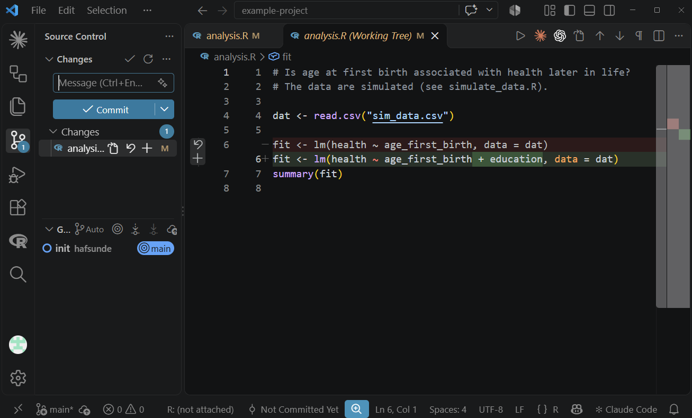
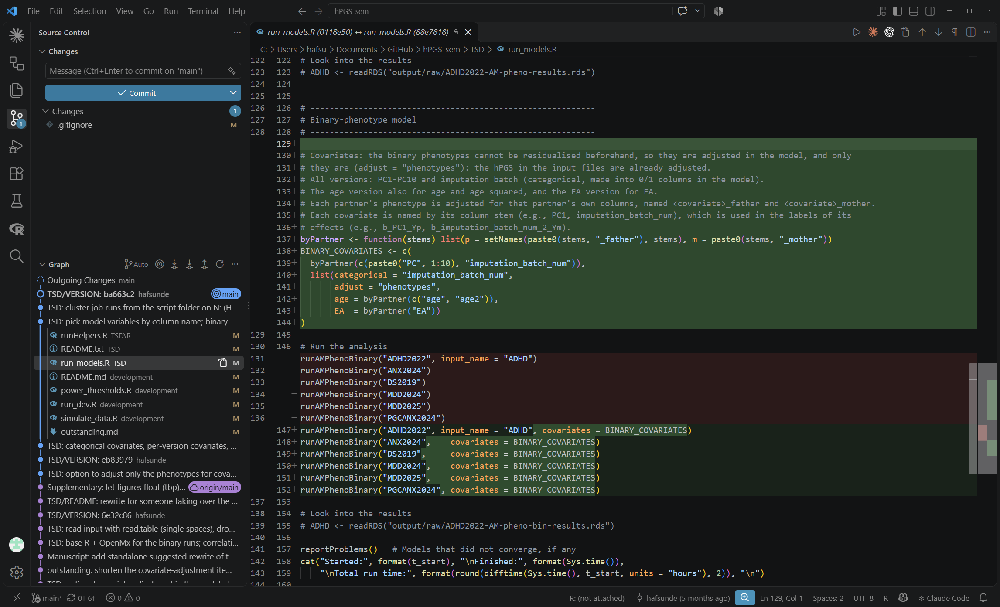
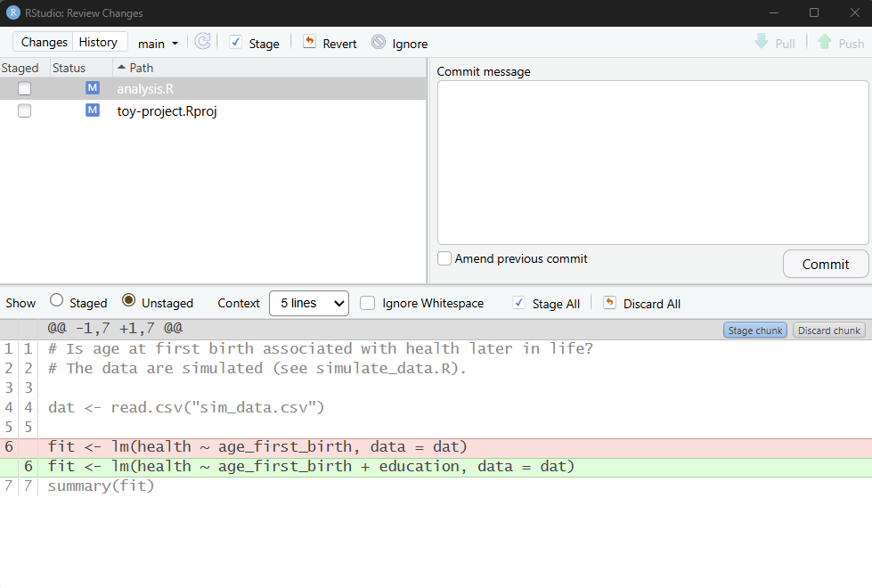

# Why bother? {background-color="#24292f"}

## Questions you can't answer today

- What did I change since I submitted?
- Which version of the code made Figure 2?
- What exactly did the AI just change?
- Which version does my coauthor have?
- Why doesn't my code work anymore?

::: {.notes}
- Revisions after 6 months: what did I change?
- AI edits many lines at once: hard to see what it did
- Git answers all of these
:::

## Sound familiar?

```
analysis.R
analysis_final.R
analysis_final_v2.R
analysis_final_v2_coauthor_comments.R
analysis_final_REALLY.R
analysis_final_REALLY_old.R
```

::: {.notes}
- Ask: who has a folder like this?
- Which file made the figures in your last paper?
- Not stupid: it's what you do without a better tool
:::

## With git

```
analysis.R
```

One file. The history is kept in the background:

```
a3f9c12  Respond to reviewer 2           12 Nov
7b2e4d0  Add sensitivity analysis         3 Oct
e81c5f3  Submitted version                1 Jun
```

::: {.notes}
- Only one `analysis.R`; old versions kept out of sight
- Left column = commit ID (hash), first 7 characters
- "Results in the paper come from e81c5f3"
:::

## What git gives you

::: {.cards}
::: {}
**Track changes**
for a whole folder
:::
::: {}
**History**
every saved version, with a note
:::
::: {}
**GitHub**
backup, sync, and sharing
:::
:::


::: {.notes}
- Track changes like Word, but for the whole folder
- GitHub = a website that keeps a copy and lets you share
- Be upfront: learning curve, then it pays off
:::

# Core ideas {background-color="#24292f"}

## Repository

::: {.def}
A project folder that git keeps an eye on.
:::

- **Analysis**: scripts and small files (`.R`, `.do`, `.csv`)
- **Writing**: papers and slides (`.tex`, `.md`, `.qmd`)

```{=html}
<details class="tip"><summary>Tip: tell git what to ignore with <code>.gitignore</code></summary>
A text file called <code>.gitignore</code> in the project folder lists files git should never track,
for example data, large output and temporary files. One pattern per line:
<code>*.rds</code> <code>*.dta</code> <code>temp_*</code> <code>data/</code> <code>.Rhistory</code>
</details>
```

::: {.notes}
- Just a normal folder; work as before
- Not only code: papers and slides are plain text too
- These slides are in git
- Small, non-sensitive `.csv` OK; real data stays out
- Tip box: `.gitignore` keeps data and clutter out
:::

## Where the history lives

```
my-project/
├── .git/          ← the history
├── analysis.R
└── README.md
```

- Created once, when you start using git in a folder
- Hidden. You never need to open it.
- Your files are the current version; `.git` holds all the earlier ones

::: {.notes}
- Hidden `.git` folder = the whole history
- Copy the folder: history comes along
- Delete `.git`: ordinary folder again
- May need "show hidden files" to see it
:::

## Commit

::: {.def}
A saved snapshot, with a short note.
:::

One commit per change that belongs together:

- "Add sensitivity analysis" ✓
- Not once a day, not every line

::: {.notes}
- Save for the whole project + a note
- Right size: one piece of work (a covariate, a bug, a reviewer comment)
- Message says why: "Adjust for education", not "changes"
:::

## Diff

::: {.def}
What changed between two versions.
:::

```{=html}
<pre class="gitdiff"><span>   # Is age at first birth associated with health?</span><span class="del">-  fit &lt;- lm(health ~ age_first_birth, data = dat)</span><span class="add">+  fit &lt;- lm(health ~ age_first_birth + education, data = dat)</span><span>   summary(fit)</span></pre>
```

[− removed]{.chip .del} [+ added]{.chip .add}

- Your edits since the last commit
- Or between commits: what came in when you pulled

::: {.notes}
- Usually: your edits since the last commit
- Also between commits: what a coauthor pushed
- Earns its place when you didn't make every change: AI, coauthor, after a break
:::

## Revert, and (optionally) stage

::: {.def}
Go through the diff like track changes in Word.
:::

:::: {.cards}
::: {}
**Revert ✗**
like *Reject change*: back to the last commit
:::
::: {}
**Stage (optional)**
commit only some changes now, the rest later
:::
::::

Anything you don't revert stays in your file.

::: {.notes}
- Revert = *Reject change*; file, block or lines
- Reverted uncommitted change is gone (editor asks first)
- Staging: optional, I seldom use it
- RStudio: tick all under *Staged*, the normal case
:::

## Revert and stage: the buttons

| | VS Code | RStudio |
|-------|-----------------|-----------------|
| File | ↶ or **+** next to the file | *More → Revert*, or tick *Staged* |
| Block | buttons next to the block in the diff | *Discard chunk* / *Stage chunk* |
| Lines | select, right-click → [*Revert / Stage Selected&nbsp;Ranges*]{style="white-space: nowrap"} | select → *Discard / Stage selection* |
| Commit | nothing staged = commit all | tick *Staged* (usually all) |

::: {.notes}
- Reference only, also in the cheat sheet; don't read it out
- Last row: VS Code can ignore staging; RStudio tick all
:::

## The cycle

```{=html}
<div class="flow">
  <div class="box">Edit and save</div>
  <div class="arrow">→</div>
  <div class="box hub">Commit</div>
  <div class="arrow loop">↻</div>
</div>
```

Check the diff when someone else made changes: an AI or a coauthor.

::: {.notes}
- Working alone: edit, save, commit. Repeat.
- Check the diff when changes aren't all yours
:::

## Your laptop and GitHub

```{=html}
<div class="flow">
  <div class="box">Your laptop</div>
  <div class="arrow">push →<br>← pull</div>
  <div class="box hub">GitHub</div>
  <div class="arrow fragment" data-fragment-index="1">← push<br>pull →</div>
  <div class="box fragment" data-fragment-index="1">Coauthor,<br>or your other computer</div>
</div>
```

- Git works offline. GitHub is the shared copy.
- Useful alone too: work laptop, home laptop, same project.

::: {.notes}
- Git works offline; GitHub is the copy online
- Push = send, pull = fetch
- Click: other end can be a coauthor or your other computer
- Git ≠ GitHub: tool vs. one place to store repos
:::

## Two ways to start

:::: {.cards}
::: {}
**Folder you already have**
initialize it, make a first commit, then publish to GitHub
:::
::: {}
**New project**
create it on GitHub, then clone it
:::
::::

```{=html}
<details><summary>Where the buttons are</summary>
<table>
<thead><tr><th></th><th>VS Code</th><th>RStudio</th></tr></thead>
<tbody>
<tr><td>Initialize a folder</td><td>Source Control → <i>Initialize Repository</i></td><td><i>Tools → Version Control → Project Setup</i> → Git</td></tr>
<tr><td>First commit</td><td>Message "First version" → <i>Commit</i></td><td>Tick all files under <i>Staged</i> → <i>Commit</i></td></tr>
<tr><td>Then publish</td><td><i>Publish Branch</i></td><td><code>usethis::use_github()</code></td></tr>
<tr><td>New repo on GitHub</td><td colspan="2">github.com: <b>+</b> → <i>New repository</i>, tick <i>Add a README</i></td></tr>
<tr><td>Then clone</td><td>Source Control → <i>Clone Repository</i></td><td><i>New Project → Version Control → Git</i></td></tr>
</tbody>
</table>
</details>
```

::: {.notes}
- Existing folder: initialize → first commit → publish
- New project: GitHub first, then clone (already connected)
- Demo 1: initialize the toy project. Demo 2: publish this workshop
- Exercise: the clone route
- Add `.gitignore` before the first commit
:::

## Words you need

| Word | Means |
|---|---|
| repository | the project folder |
| commit | saved snapshot + note |
| diff | what changed |
| stage | (optional) pick which changes go in the next commit |
| push | send commits to GitHub |
| pull | get commits from GitHub |
| clone | download a repo the first time |

::: {.notes}
- Full vocabulary for today
- "Branch": side version; later, not needed to start
- All in the cheat sheet
:::

# Demo 1: VS Code and RStudio {background-color="#c2410c"}

## What I'll show

:::: {.columns}
::: {.column width="45%"}
- Turn a project folder into a repo
- Edit a script, see the diff, commit
- Let an AI edit, review it
- Look back in history
- Then the same in RStudio
:::
::: {.column width="55%"}
{fig-alt="VS Code Source Control panel with analysis.R open in diff view: the lm() line gains + education"}
:::
::::

::: {.notes}
- **DEMO 1 NOW**: run sheet in `workshop-plan.md`
- Font large; screenshots if it fails
:::

## Reviewing AI edits

::: {.steps}
1. **Commit** before the AI starts
2. Let it edit
3. **Read the diff**
4. **Revert** what you didn't ask for, commit the rest
:::

::: {.notes}
- Maybe the strongest reason to start now
- Commit first = safe point to go back to
- Review the diff like a referee
- All wrong? Discard everything
:::

## History

:::: {.columns}
::: {.column width="45%"}
- Every commit can be opened
- See what changed, and when
- Get an old version back
:::
::: {.column width="55%"}
::: {.panel-tabset}

### VS Code

{fig-alt="VS Code Graph view with a long list of commits; one commit is selected and its change to run_models.R is shown as a diff" style="max-height: 640px; width: auto;"}

### RStudio

{fig-alt="RStudio History window: list of commits with message, author, date and SHA; the selected commit's changed files and diff are shown below" style="max-height: 640px; width: auto;"}

:::
:::
::::

::: {.notes}
- Click an old commit, show its diff
- Reviewer asks "what did you change?": now you can answer
- Tabs: same view in RStudio
:::

## Same buttons, different places

::: {.panel-tabset}
### Buttons

| | VS Code | RStudio |
|---|---|---|
| See changes | Source Control (left bar) | Git pane (top right) |
| Diff | click the file | *Diff* |
| Commit | type message, *Commit* | tick, *Commit* |
| Push and pull | *Sync Changes* | green / blue arrow |
| History | *Graph* / Timeline | clock icon |

### VS Code diff

{fig-alt="VS Code Source Control panel with analysis.R open in diff view: the lm() line gains + education" style="max-height: 580px; width: auto;"}

### RStudio diff

{fig-alt="RStudio Review Changes window: analysis.R selected, diff shows the lm() line gaining + education, with Stage chunk and Discard chunk buttons" style="max-height: 580px; width: auto;"}
:::

::: {.notes}
- RStudio part of Demo 1: open the same `toy-project`
- Git tab is there: git lives in the folder, not the editor
- Same history (clock icon), small edit, *Diff*
- If time: initialize `toy-project-rstudio`
- No Git tab: not a project, or RStudio open while git was installed
- Stata: use VS Code
:::

# GitHub {background-color="#24292f"}

## Why GitHub

- **Share your code** with the paper
- Work with coauthors
- Same project on several computers
- Backup off your laptop

::: {.notes}
- Sharing is the main reason; journals ask for code
- Zenodo: citable DOI for the exact version
- Private repos are free
:::

## Working with others

- Invite coauthors to the repo
- **Pull** before you start
- **Push** when you're done

::: {.callout-note}
## Both edited the same line?
Git asks you to choose.
:::

::: {.notes}
- Mostly: pull before, push after
- Same line changed by two people = merge conflict
- Looks scary, editors help, rare if you pull often
:::

## Making code public

::: {.callout-warning}
## A public repo shows the whole history
Old versions, old comments, files you deleted
:::

::: {.callout-tip .fragment}
## Tip
Copy the final code into a **new repo**, and make that public
:::

::: {.notes}
- Every commit visible, incl. deleted files and old comments
- Often fine
- If not: new repo with the final code; keep the original private
:::

# Demo 2: GitHub {background-color="#c2410c"}

## What I'll show

::: {.steps}
1. Publish this workshop's folder to GitHub, as a public repo
2. Look at it on github.com: files, commits, a diff
3. Edit on github.com, as a coauthor would
4. Pull the change back to my laptop
:::

::: {.notes}
- **DEMO 2 NOW**: run sheet in `workshop-plan.md`
- Publish `git-demo` as **public**, keep the name (the clone link)
:::

# Your turn {background-color="#c2410c"}

## Exercise 1: set up git and clone this workshop

::: {.steps}
1. Install git
2. Restart RStudio / VS Code
3. Tell git who you are
4. Clone the workshop repo
:::

No GitHub account needed yet. Pairs are fine.

::: {.notes}
- One slide per step follows
- No account needed; pairs fine
- Clone works → they have exercises, cheat sheet, slides
:::

## 1. Install git

| | |
|---|---|
| Work laptop (Windows) | *Company Portal* (*Firmaportal*) → search **Git** → *Install* |
| Private laptop (Windows) | <https://git-scm.com/downloads/win>, click *Next* through everything |
| Mac | *Terminal* app → type `git --version` → *Install* if asked |

::: {.notes}
- Mac: version number printed = already installed
- VS Code users: terminal once more in step 3
:::

## 2. Restart your editor

| | |
|---|---|
| RStudio | Restart. Check *Tools → Global Options → Git/SVN*: "Git executable" shows a path |
| VS Code | Restart. Git support is built in |

Stata: use VS Code for git.

::: {.notes}
- Editor only looks for git at start-up
- "Git not found" / no Git tab = restart
:::

## 3. Tell git who you are {.top}

Every commit records **who** made it: a name and an email.
Git won't commit until it knows. GitHub uses the email to link commits to your account.

::: {.panel-tabset}
### RStudio (R console)

```r
install.packages("usethis")
usethis::use_git_config(
  user.name  = "Your Name",
  user.email = "you@example.com"
)
usethis::git_sitrep()   # check
```

### VS Code (terminal)

*Terminal → New Terminal*, then one line at a time:

```bash
git config --global user.name "Your Name"
git config --global user.email "you@example.com"
git config --global --list   # check
```
:::

Use the email you use (or will use) for GitHub. You only do this once per computer.

::: {.notes}
- VS Code has no button: two lines in the terminal
- usethis route works for VS Code users with R too
- Token warnings in `git_sitrep()`: fine for now
:::

## 4. Clone the workshop repo {.top}

**<https://github.com/hafsunde/git-demo>**

:::: {.columns}
::: {.column width="50%"}
**VS Code**

::: {.steps}
1. *File → Close Folder*
2. Source Control → *Clone Repository*
3. Paste the link, Enter
4. Choose a folder → *Open*
:::
:::
::: {.column width="50%"}
**RStudio**

::: {.steps}
1. *File → New Project*
2. *Version Control → Git*
3. Paste the link
4. Choose a folder → *Create Project*
:::
:::
::::

Not in OneDrive or Dropbox. Then open `participants/exercise-2-github.md`.

::: {.notes}
- Clone = download with the whole history
- Public repo: no login needed
- Suggest `Documents/GitHub`
- Done early: look at the history, click a commit
:::

## Exercise 2: your own repo on GitHub

::: {.steps}
1. GitHub account (if needed), then new repo on github.com, with a README
2. Clone it to your laptop
3. Edit the README, save
4. Look at the diff, commit
5. Push, refresh github.com
:::

Steps: `participants/exercise-2-github.md`

::: {.notes}
- Adapt to where people are
- One working laptop per pair is enough
- No setup: steps 3–5 in the browser (pencil icon)
- Most common problem: login at first push
:::

# Is it worth it? {background-color="#24292f"}

## It's a hurdle

:::: {.columns}
::: {.column width="50%"}
::: {.callout-caution appearance="simple" icon="false"}
## First week
- New words, new buttons
- The first login is fiddly
- You'll feel slower
:::
:::
::: {.column width="50%" .fragment}
::: {.callout-tip appearance="simple" icon="false"}
## Then
- You never lose work
- You can review changes
- Much better integration with AI
- Your code is ready to share
:::
:::
::::

::: {.notes}
- It took me a while too
- Use it on one real project, every day, for two weeks
:::

## Tips

- One commit per change; say *why*
- Pull when you start, push when you're done
- Plain text works best (`.R`, `.do`, `.tex`, `.md`)
- LaTeX/Markdown: one sentence per line
- No repos inside OneDrive/Dropbox

::: {.notes}
- Word, Excel, `.dta`: tracked, but no readable diff
- One sentence per line: git compares lines
- OneDrive/Dropbox fight with git: use `Documents/GitHub`
:::

## An idea for TSD

```{=html}
<div class="flow">
  <div class="box">TSD scripts<br>(in git)</div>
  <div class="arrow">copy in<br>→</div>
  <div class="box secure">TSD<br>real data</div>
  <div class="arrow">results<br>→</div>
  <div class="box">Figures, tables,<br>manuscript (in git)</div>
</div>
```

- Keep a copy of the TSD scripts in a local repo
- Edit there, copy to TSD, run, bring results back
- Git also works on TSD, just not connected to GitHub

```{=html}
<details><summary>Bonus: test locally with fake data</summary>
A small script makes fake data with the same columns, so the server scripts run on your laptop.
</details>
```

::: {.notes}
- One way, not the only way
- Git works on TSD, but no GitHub: no push, backup or sharing
- My setup: server scripts in a local repo → copy in → run → aggregate results back
- Bonus: fake data with the same columns, so scripts run locally
- Expandable box is for people reading later
:::

## Learn more

- *Happy Git and GitHub for the useR*: [happygitwithr.com](https://happygitwithr.com)
- GitHub Docs: [docs.github.com](https://docs.github.com)
- This workshop: [github.com/hafsunde/git-demo](https://github.com/hafsunde/git-demo) (cheat sheet in `participants/`)

::: {.callout-note appearance="simple"}
Most guides use the command line. Same git, typed instead of clicked.
:::

::: {.notes}
- Happy Git with R (Jenny Bryan): written for this audience
- Most guides use commands: same git, typed instead of clicked
:::

# Questions? {background-color="#24292f"}

::: {.notes}
Possible questions, short answers:

- **Git on TSD?** Can be installed; I keep a local mirror
- **Stata?** No git button; use VS Code
- **Overleaf?** Syncs with GitHub on a paid plan; or write LaTeX locally
- **Command line?** Not to start; same git, maybe later
- **OneDrive/Dropbox?** Don't put repos there; they fight
- **Word/Excel?** Tracked, but no readable diff; plain text works best
- **Branches?** Side versions; useful later, not needed to start
- **Citing code?** GitHub + Zenodo gives a DOI
:::
