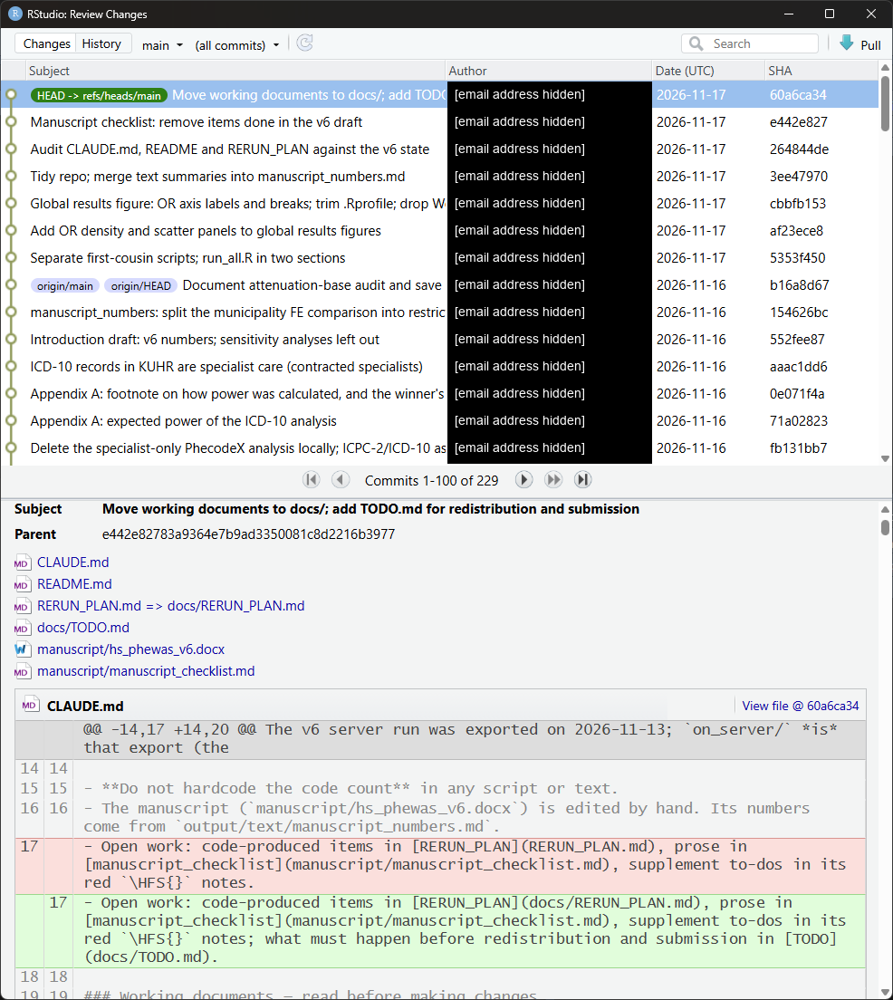

# Why bother? {background-color="#24292f"}

## Questions you can't answer today

- What did I change since I submitted?
- Which version of the code made Figure 2?
- What exactly did the AI just change?
- Which version does my coauthor have?
- Why doesn't my code work anymore?

::: {.notes}
These are the real costs. Revisions come back after 6 months and you can't tell what changed. AI tools now edit many lines at once, and it's hard to see what they did unless you have a tool that shows you. Git answers all four questions.
:::

## Sound familiar?

```
analysis.R
analysis_final.R
analysis_final_v2.R
analysis_final_v2_coauthor_comments.R
analysis_final_REALLY.R
analysis_final_REALLY_old.R
```

::: {.notes}
Something everyone recognises. Ask: who has a folder like this? Who knows which of these files produced the figures in their last paper? The point is not that this is stupid. It's what everyone does when they have no better tool.
:::

## With git

```
analysis.R
```

One file. The history is kept in the background:

```
a3f9c12  Respond to reviewer 2           12 Nov
7b2e4d0  Add sensitivity analysis         3 Oct
e81c5f3  Submitted version                1 Jun
```

::: {.notes}
This is the big change in how it feels to work. There is only one analysis.R. You don't keep old copies, because git stores every saved version for you, out of sight. You only ever think about the current file. When you need an old version, you ask git for it.

The codes on the left are the commit IDs, called hashes. Every commit gets a unique one. Usually you see the first 7 characters. You rarely type them, but they're a precise way to point to a version: "the results in the paper come from e81c5f3".
:::

## What git gives you

::: {.cards}
::: {}
**Track changes**
for a whole folder
:::
::: {}
**History**
every saved version, with a note
:::
::: {}
**GitHub**
backup, sync, and sharing
:::
:::


::: {.notes}
Word users know track changes. Git is the same idea, but for every file in a project folder, and it keeps the full history. GitHub is a website that stores a copy and lets you share it. Be upfront that there is a learning curve. It's a handful of new words and a few buttons, and after that it pays off for the rest of your career.
:::

# Core ideas {background-color="#24292f"}

## Repository

::: {.def}
A project folder that git keeps an eye on.
:::

- Your R scripts, `.do` files, `.tex`, `.md`
- Git notices every change
- Nothing goes into the history until you say so

```{=html}
<details class="tip"><summary>Tip: tell git what to ignore with <code>.gitignore</code></summary>
A text file called <code>.gitignore</code> in the project folder lists files git should never track,
for example data, large output and temporary files. One pattern per line:
<code>*.rds</code> <code>*.dta</code> <code>temp_*</code> <code>data/</code> <code>.Rhistory</code>
</details>
```

::: {.notes}
A repository, or repo, is just a normal folder. You keep working in it exactly as before. Git sees changes as soon as you save a file, but it doesn't record them until you make a commit.

The tip box (click to open): a .gitignore file tells git which files to leave alone. Useful for data files, big outputs, and clutter like .Rhistory. Ignored files never show up as changes, so you can't commit them by accident. RStudio creates a basic one when you make a project with git.
:::

## Where the history lives

```
my-project/
├── .git/          ← the history
├── analysis.R
└── README.md
```

- Created once, when you start using git in a folder
- Hidden. You never need to open it.
- Your files are the current version; `.git` holds all the earlier ones

::: {.notes}
When you turn a folder into a repository (in VS Code: "Initialize Repository"; in RStudio: when you create a project with git, or clone one), git creates a hidden folder called .git inside it. That folder is the whole history. Each commit stores a compressed snapshot of the project. Files that didn't change aren't stored again, so it stays small for code. When you open an old version, git takes it out of .git and puts it back in your folder. Copy the folder, and the history comes along. Delete .git, and it's an ordinary folder again, without history. You may need to turn on "show hidden files" to even see it, and that's fine.
:::

## Commit

::: {.def}
A saved snapshot, with a short note.
:::

One commit per change that belongs together:

- "Add sensitivity analysis" ✓
- Not once a day, not every line

::: {.notes}
A commit is the core concept. It's like pressing save on the whole project, plus writing a note about what you did and why. The right size is one piece of work: adding a covariate, fixing a bug, responding to one reviewer comment. Not "everything I did on Tuesday", because then you can't find or undo one change. Not every single line, because then the history is noise. A good message says what and why: "Adjust for education" is better than "changes".
:::

## Diff

::: {.def}
What changed between two versions.
:::

```{=html}
<pre class="gitdiff"><span>   # Is age at first birth associated with health?</span><span class="del">-  fit &lt;- lm(health ~ age_first_birth, data = dat)</span><span class="add">+  fit &lt;- lm(health ~ age_first_birth + education, data = dat)</span><span>   summary(fit)</span></pre>
```

[− removed]{.chip .del} [+ added]{.chip .add}

- Your edits since the last commit
- Or between commits: what came in when you pulled

::: {.notes}
The diff shows exactly which lines changed, in every file. Most often you see it for your own unsaved-to-git edits: what changed since the last commit. But it works between any two versions. Example: a coauthor pushed three commits while you were away. After you pull, open the history and click their commits to see exactly what they changed since you last worked on the project. VS Code: click a commit in the Graph. RStudio: the History window. GitHub: click a commit, or compare two versions.

You don't need it for every commit of your own: when you made the change yourself, you know what it is. It earns its place when you didn't make every change yourself: after an AI edit, after pulling a coauthor's work, or when you come back after a break and wonder what you were doing.
:::

## Revert, and (optionally) stage

::: {.def}
Go through the diff like track changes in Word.
:::

:::: {.cards}
::: {}
**Revert ✗**
like *Reject change*: back to the last commit
:::
::: {}
**Stage (optional)**
commit only some changes now, the rest later
:::
::::

Anything you don't revert stays in your file.

::: {.notes}
The diff isn't just for looking. You can act on it, a bit like track changes in Word. Revert, or discard, is like "Reject change": the lines go back to how they were at the last commit. You can do it for a whole file, one block, or single lines. This is how you review an AI edit: revert what you didn't ask for, commit the rest. Careful: a reverted change that was never committed is gone. VS Code and RStudio ask you to confirm.

Staging is optional, and I seldom use it. It's not quite "Accept change": everything you don't revert is already in your file. Staging only chooses what goes into this particular commit. Useful when you made two unrelated changes and want two clean commits: stage one, commit, then commit the rest. If nothing is staged, VS Code just offers to commit everything. RStudio is different: you always tick the files under Staged before committing. Ticking all of them is the normal case, so in practice it's the same: everything goes in unless you choose otherwise.
:::

## Revert and stage: the buttons

| | VS Code | RStudio |
|-------|-----------------|-----------------|
| File | ↶ or **+** next to the file | *More → Revert*, or tick *Staged* |
| Block | buttons next to the block in the diff | *Discard chunk* / *Stage chunk* |
| Lines | select, right-click → [*Revert / Stage Selected&nbsp;Ranges*]{style="white-space: nowrap"} | select → *Discard / Stage selection* |
| Commit | nothing staged = commit all | tick *Staged* (usually all) |

::: {.notes}
For reference; also in the cheat sheet. Don't read the table out. Point at the last row: in VS Code you can ignore staging completely; in RStudio you tick the files, normally all of them.
:::

## The cycle

```{=html}
<div class="flow">
  <div class="box">Edit and save</div>
  <div class="arrow">→</div>
  <div class="box hub">Commit</div>
  <div class="arrow loop">↻</div>
</div>
```

Check the diff when someone else made changes: an AI or a coauthor.

::: {.notes}
That's all there is to working alone. Edit and save as usual, and commit with a message when a piece of work is done. Repeat. When the changes aren't all yours, from an AI tool or a coauthor, look at the diff before you commit or carry on.
:::

## Your laptop and GitHub

```{=html}
<div class="flow">
  <div class="box">Your laptop</div>
  <div class="arrow">push →<br>← pull</div>
  <div class="box hub">GitHub</div>
  <div class="arrow fragment" data-fragment-index="1">← push<br>pull →</div>
  <div class="box fragment" data-fragment-index="1">Coauthor,<br>or your other computer</div>
</div>
```

- Git works offline. GitHub is the shared copy.
- Useful alone too: work laptop, home laptop, same project.

::: {.notes}
Git runs on your own computer. Everything so far works offline. GitHub is a copy online. Push sends your commits to GitHub. Pull fetches commits from GitHub. Click: the other end can be a coauthor, but just as often it's yourself on another machine: the work laptop and the home laptop, or an old and a new computer. Pull when you sit down, push when you're done, and both machines stay in sync. Git and GitHub are not the same thing: git is the tool, GitHub is one place to store repos.
:::

## Two ways to start

:::: {.cards}
::: {}
**Folder you already have**
initialize it, make a first commit, then publish to GitHub
:::
::: {}
**New project**
create it on GitHub, then clone it
:::
::::

```{=html}
<details><summary>Where the buttons are</summary>
<table>
<thead><tr><th></th><th>VS Code</th><th>RStudio</th></tr></thead>
<tbody>
<tr><td>Initialize a folder</td><td>Source Control → <i>Initialize Repository</i></td><td><i>Tools → Version Control → Project Setup</i> → Git</td></tr>
<tr><td>First commit</td><td>Message "First version" → <i>Commit</i></td><td>Tick all files under <i>Staged</i> → <i>Commit</i></td></tr>
<tr><td>Then publish</td><td><i>Publish Branch</i></td><td><code>usethis::use_github()</code></td></tr>
<tr><td>New repo on GitHub</td><td colspan="2">github.com: <b>+</b> → <i>New repository</i>, tick <i>Add a README</i></td></tr>
<tr><td>Then clone</td><td>Source Control → <i>Clone Repository</i></td><td><i>New Project → Version Control → Git</i></td></tr>
</tbody>
</table>
</details>
```

::: {.notes}
There are two ways to get a repository. If you already have a project folder, turn it into a repo where it is: that's "initialize". Git starts watching the folder, nothing is moved or uploaded. But initializing doesn't save anything yet: until the first commit, there is no history and nothing to publish. So make a first commit of everything, then publish it to GitHub when you want a backup. I'll do this in the demo with the toy project. If you're starting something new, it's often easier the other way round: create an empty repo on GitHub first, then clone it to your laptop. Then it's already connected, and push and pull just work. That's what you'll do in the exercise. Before initializing an existing folder, add a .gitignore so the data never gets committed.
:::

## Words you need

| Word | Means |
|---|---|
| repository | the project folder |
| commit | saved snapshot + note |
| diff | what changed |
| stage | (optional) pick which changes go in the next commit |
| push | send commits to GitHub |
| pull | get commits from GitHub |
| clone | download a repo the first time |

::: {.notes}
This is the full vocabulary for today. You'll come across "branch" online: a side version of the project. Useful later, not needed to start. Point to the cheat sheet in the repo.
:::

# Demo: VS Code {background-color="#0969da"}

## What I'll show

:::: {.columns}
::: {.column width="45%"}
- Turn a project folder into a repo
- Edit a script, see the diff, commit
- Let an AI edit, review it
- Look back in history
:::
::: {.column width="55%"}
{fig-alt="VS Code Source Control panel with analysis.R open in diff view: the lm() line gains + education"}
:::
::::

::: {.notes}
Live demo. Follow the demo script in workshop-plan.md section 4. If the demo fails, use the screenshots. Keep the font large.
:::

## Reviewing AI edits

::: {.steps}
1. **Commit** before the AI starts
2. Let it edit
3. **Read the diff**
4. **Revert** what you didn't ask for, commit the rest
:::

::: {.notes}
This is maybe the strongest reason to start using git now. AI assistants in VS Code or RStudio can change many files at once. Without git, you have to trust it or read everything again. With git, you commit first, so you always have a safe point to go back to. Then you review the diff like a referee: keep what you asked for, undo the rest. If it all goes wrong, discard everything and you're back where you were.
:::

## History

:::: {.columns}
::: {.column width="45%"}
- Every commit can be opened
- See what changed, and when
- Get an old version back
:::
::: {.column width="55%"}
::: {.panel-tabset}

### VS Code

{fig-alt="VS Code Graph view with a long list of commits; one commit is selected and its change to run_models.R is shown as a diff" style="max-height: 640px; width: auto;"}

### RStudio

{fig-alt="RStudio History window: list of commits with message, author, date and SHA; the selected commit's changed files and diff are shown below" style="max-height: 640px; width: auto;"}

:::
:::
::::

::: {.notes}
Show the timeline or graph view. Click an old commit and show its diff. Mention that reviewers asking "what did you change?" can now be answered precisely. The tabs on the slide show where the same view is in RStudio.
:::

# GitHub {background-color="#24292f"}

## Why GitHub

- **Share your code** with the paper
- Work with coauthors
- Same project on several computers
- Backup off your laptop

::: {.notes}
Sharing is the main reason. Journals increasingly ask for code, and a link to a GitHub repo is the standard way to give it. Linking the repo to Zenodo gives a citable DOI for the exact version used in the paper. Private repos are free, so you can keep a project private until you're ready. Demo: push, refresh github.com, show the commits and a diff in the browser.
:::

## Working with others

- Invite coauthors to the repo
- **Pull** before you start
- **Push** when you're done

::: {.callout-note}
## Both edited the same line?
Git asks you to choose.
:::

::: {.notes}
Collaboration is mostly pull before, push after. If two people change the same lines, git can't decide and asks you which version to keep. This is called a merge conflict. It looks scary the first time, but VS Code and RStudio help you through it, and it's rare if you pull often.
:::

## Making code public

::: {.callout-warning}
## A public repo shows the whole history
Old versions, old comments, files you deleted
:::

::: {.callout-tip .fragment}
## Tip
Copy the final code into a **new repo**, and make that public
:::

::: {.notes}
When you make a repo public, everyone can see every commit ever made, not only the current files. That includes half-finished code, comments to coauthors, and files you deleted long ago: deleting a file only removes it from new versions, not from the history. Often that's fine. If not, the simple fix is to create a fresh repository, copy in the final version of the code, and publish that one. Keep the original private for your own history.
:::

## Same buttons, different places

::: {.panel-tabset}
### Buttons

| | VS Code | RStudio |
|---|---|---|
| See changes | Source Control (left bar) | Git pane (top right) |
| Diff | click the file | *Diff* |
| Commit | type message, *Commit* | tick, *Commit* |
| Push and pull | *Sync Changes* | green / blue arrow |
| History | *Graph* / Timeline | clock icon |

### VS Code diff

{fig-alt="VS Code Source Control panel with analysis.R open in diff view: the lm() line gains + education" style="max-height: 580px; width: auto;"}

### RStudio diff

{fig-alt="RStudio Review Changes window: analysis.R selected, diff shows the lm() line gaining + education, with Stage chunk and Discard chunk buttons" style="max-height: 580px; width: auto;"}
:::

::: {.notes}
Demo 2: open the same project in RStudio. VS Code's Sync Changes does pull and push in one click; RStudio has separate buttons. RStudio only shows the Git pane when the folder is an RStudio project and git was installed before RStudio started. Pull the change made on the web, then commit and push something. The second tab is a fallback screenshot of RStudio's diff window: same diff as in VS Code, with Stage chunk and Discard chunk on the right. Stata users: Stata has no git button; open the folder in VS Code.
:::

# Your turn {background-color="#0969da"}

## Exercise (15 min)

::: {.steps}
1. New repo on github.com, with a README
2. Clone it to your laptop
3. Edit the README, save
4. Look at the diff, commit
5. Push, refresh github.com
:::

Steps: `participants/exercise.md`

::: {.notes}
Pairs are fine. People without a working setup can do steps 3 to 5 in the browser on github.com (pencil icon). Walk around. The most common problem will be the login at the first push.
:::

# Is it worth it? {background-color="#24292f"}

## It's a hurdle

:::: {.columns}
::: {.column width="50%"}
::: {.callout-caution appearance="simple" icon="false"}
## First week
- New words, new buttons
- The first login is fiddly
- You'll feel slower
:::
:::
::: {.column width="50%" .fragment}
::: {.callout-tip appearance="simple" icon="false"}
## Then
- You never lose work
- You can review changes
- Much better integration with AI
- Your code is ready to share
:::
:::
::::

::: {.notes}
Say this plainly. It took me a while too. The fix is to just use it on one real project, every day, for a couple of weeks. After that, you won't want to work without it.
:::

## Tips

- One commit per change; say *why*
- Pull when you start, push when you're done
- Plain text works best (`.R`, `.do`, `.tex`, `.md`)
- LaTeX/Markdown: one sentence per line
- No repos inside OneDrive/Dropbox

::: {.notes}
Word, Excel and .dta files can be committed but git can't show what changed inside them. One sentence per line in LaTeX and Markdown makes diffs readable, since git compares lines. OneDrive and Dropbox sync and git interfere with each other; keep repos in a plain local folder like Documents/GitHub. Overleaf can sync with GitHub but only on a paid plan.
:::

## An idea for TSD

```{=html}
<div class="flow">
  <div class="box">TSD scripts<br>(in git)</div>
  <div class="arrow">copy in<br>→</div>
  <div class="box secure">TSD<br>real data</div>
  <div class="arrow">results<br>→</div>
  <div class="box">Figures, tables,<br>manuscript (in git)</div>
</div>
```

- Keep a copy of the TSD scripts in a local repo
- Edit there, copy to TSD, run, bring results back
- Git also works on TSD, just not connected to GitHub

```{=html}
<details><summary>Bonus: test locally with fake data</summary>
A small script makes fake data with the same columns, so the server scripts run on your laptop.
</details>
```

::: {.notes}
One way to do it, not the only way. Git can be installed on TSD, and it works there for tracking changes and history. But TSD can't reach GitHub, so there's no push or pull, no backup off the server, and no sharing. I don't use it there. Instead I keep a mirror of the pipeline locally: the server scripts live in a folder in my local repo. I edit them there, copy the folder to TSD, run it, and export the aggregate results back into the repo. Local scripts turn them into figures and tables. A bonus: a small script that makes fake data with the same columns lets me run the server scripts locally, and build figures before the real results exist. The expandable box is for people reading the slides afterwards.
:::

## Learn more

- *Happy Git and GitHub for the useR*: [happygitwithr.com](https://happygitwithr.com)
- GitHub Docs: [docs.github.com](https://docs.github.com)
- This workshop: `participants/cheatsheet.md`

::: {.callout-note appearance="simple"}
Most guides use the command line. Same git, typed instead of clicked.
:::

::: {.notes}
Happy Git with R by Jenny Bryan is written exactly for this audience. Today I used buttons in VS Code and RStudio to keep things simple, but everything can also be done by typing commands, and many people prefer that. Most guides and Stack Overflow answers show commands. Don't let that put you off: it's the same git underneath, and the buttons do the same thing. Add the link to this repo once it's on GitHub.
:::

# Questions? {background-color="#24292f"}

::: {.notes}
Possible questions: Can I use git on TSD? (yes, it can be installed; I keep a local mirror instead). What about Stata? (VS Code). Does it work with Overleaf? (paid plan, or keep LaTeX locally). Should I learn the command line? (not to start; maybe later).
:::
