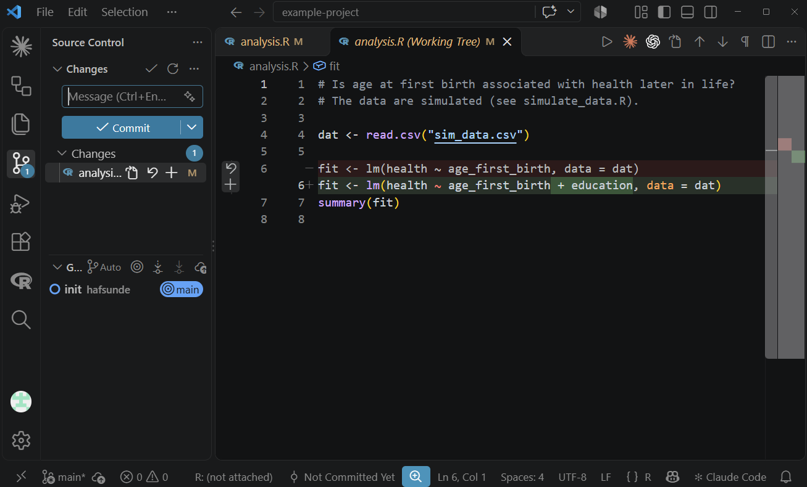
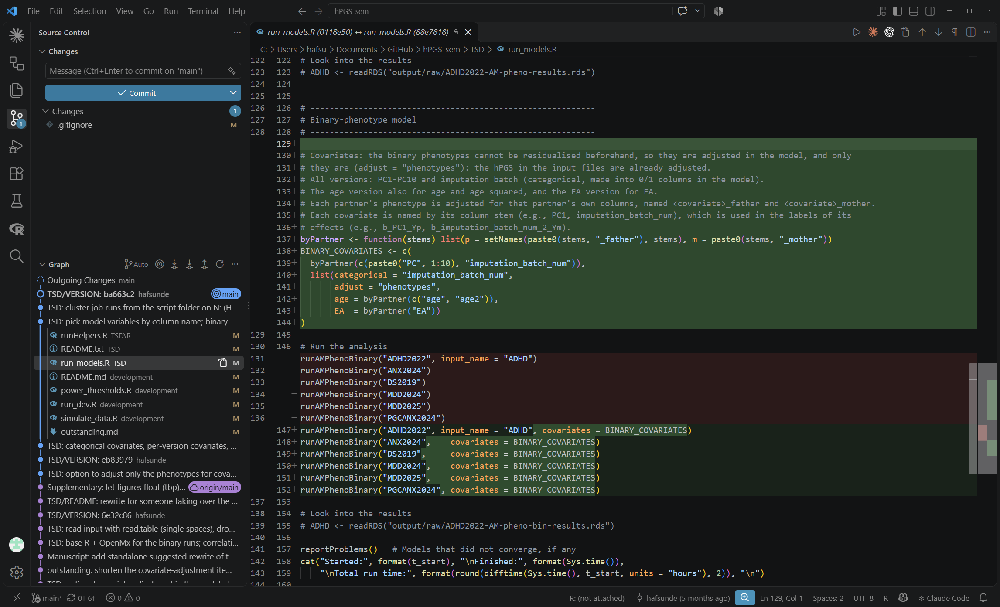
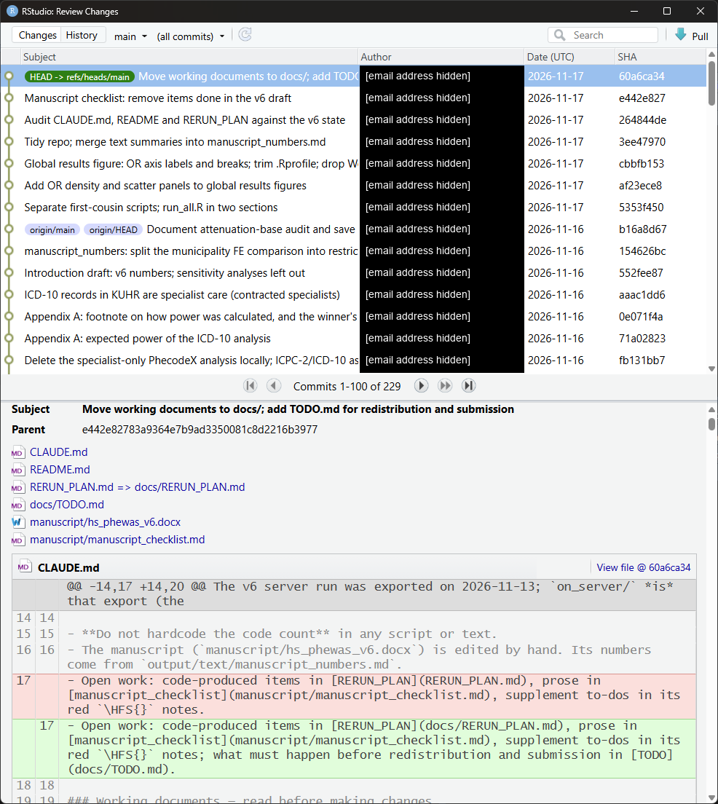
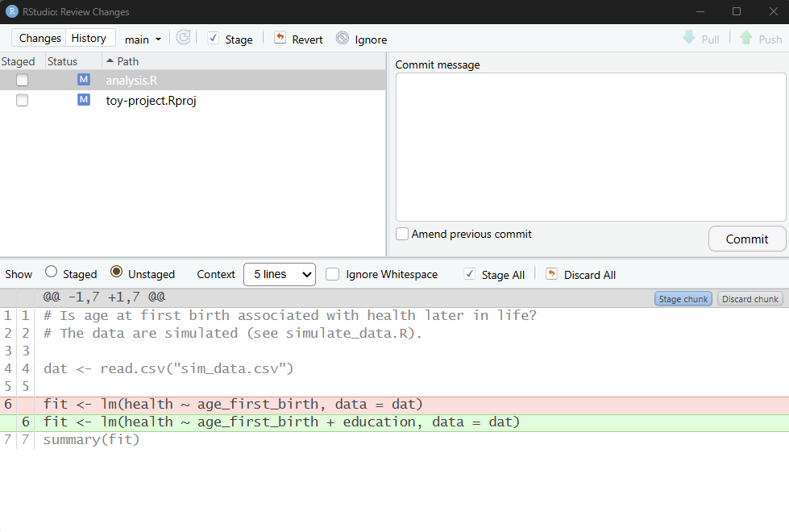

# Hvorfor bry seg? {background-color="#24292f"}

## Spørsmål du ikke kan svare på i dag

- Hva har jeg endret siden jeg sendte inn?
- Hvilken versjon av koden lagde Figur 2?
- Hva var det egentlig AI-en endret nå?
- Hvilken versjon har medforfatteren min?
- Hvorfor virker ikke koden min lenger?

::: {.notes}
- Revisjon etter 6 måneder: hva endret jeg?
- AI endrer mange linjer på en gang: vanskelig å se hva den gjorde
- Git svarer på alle disse
:::

## Kjenner du deg igjen?

```
analysis.R
analysis_final.R
analysis_final_v2.R
analysis_final_v2_coauthor_comments.R
analysis_final_REALLY.R
analysis_final_REALLY_old.R
```

::: {.notes}
- Spør: hvem har en mappe som dette?
- Hvilken fil lagde figurene i den siste artikkelen din?
- Ikke dumt: det er det man gjør uten et bedre verktøy
:::

## Med git

```
analysis.R
```

Én fil. Historikken lagres i bakgrunnen:

```
a3f9c12  Respond to reviewer 2           12 Nov
7b2e4d0  Add sensitivity analysis         3 Oct
e81c5f3  Submitted version                1 Jun
```

::: {.notes}
- Bare én `analysis.R`; gamle versjoner ligger skjult
- Venstre kolonne = commit-ID (hash), de første 7 tegnene
- «Resultatene i artikkelen kommer fra e81c5f3»
:::

## Hva git gir deg

::: {.cards}
::: {}
**Spor endringer**
for en hel mappe
:::
::: {}
**Historikk**
hver lagrede versjon, med en notis
:::
::: {}
**GitHub**
backup, synkronisering og deling
:::
:::


::: {.notes}
- Som «Spor endringer» i Word, men for hele mappen
- GitHub = en nettside som tar vare på en kopi og lar deg dele
- Vær ærlig: det er en læringskurve, men så lønner det seg
:::

# Grunnbegreper {background-color="#24292f"}

## Ord du trenger

| Ord | Betyr |
|---|---|
| *repository* (*repo*) | prosjektmappen |
| *commit* | lagret øyeblikksbilde + notis |
| *diff* | hva som er endret |
| *stage* | (valgfritt) velg endringer til neste *commit* |
| *push* | send *commits* til GitHub |
| *pull* | hent *commits* fra GitHub |
| *clone* | last ned et *repo* første gang |

::: {.notes}
- Alle ordene for i dag; hvert av dem kommer straks
- «Branch»: en sideversjon; nyttig senere, ikke nødvendig for å starte
- Alt står i juksearket (cheatsheet)
:::

## Repository

::: {.def}
En prosjektmappe som git holder øye med.
:::

- **Analyse**: skript og små filer (`.R`, `.do`, `.csv`)
- **Skriving**: artikler og presentasjoner (`.tex`, `.md`, `.qmd`)

```{=html}
<details class="tip"><summary>Tips: fortell git hva den skal ignorere med <code>.gitignore</code></summary>
En tekstfil som heter <code>.gitignore</code> i prosjektmappen, lister opp filer git aldri skal spore,
for eksempel data, store resultatfiler og midlertidige filer. Ett mønster per linje:
<code>*.rds</code> <code>*.dta</code> <code>temp_*</code> <code>data/</code> <code>.Rhistory</code>
</details>
```

::: {.notes}
- Bare en vanlig mappe; jobb som før
- Ikke bare kode: artikler og presentasjoner er også ren tekst
- Disse lysbildene ligger i git
- Små, ikke-sensitive `.csv` er OK; ekte data holdes utenfor
- Tipsboksen: `.gitignore` holder data og rot utenfor
:::

## Hvor historikken ligger

```
my-project/
├── .git/          ← historikken
├── analysis.R
└── README.md
```

- Lages én gang, når du begynner å bruke git i en mappe
- Skjult. Du trenger aldri å åpne den.
- Filene dine er den nåværende versjonen; `.git` har alle de tidligere

::: {.notes}
- Skjult `.git`-mappe = hele historikken
- Kopier mappen: historikken blir med
- Slett `.git`: vanlig mappe igjen
- Må kanskje slå på «vis skjulte filer» for å se den
:::

## Commit

::: {.def}
Et lagret øyeblikksbilde, med en kort notis.
:::

Én *commit* per endring som hører sammen:

- «Add sensitivity analysis» ✓
- Ikke én gang om dagen, ikke for hver linje

::: {.notes}
- Lagrer hele prosjektet + en notis
- Riktig størrelse: én ting (en kovariat, en bug, en kommentar fra fagfellen)
- Meldingen sier hvorfor: «Adjust for education», ikke «changes»
:::

## Diff

::: {.def}
Hva som er endret mellom to versjoner.
:::

```{=html}
<pre class="gitdiff"><span>   # Henger alder ved første fødsel sammen med helse?</span><span class="del">-  fit &lt;- lm(health ~ age_first_birth, data = dat)</span><span class="add">+  fit &lt;- lm(health ~ age_first_birth + education, data = dat)</span><span>   summary(fit)</span></pre>
```

[− fjernet]{.chip .del} [+ lagt til]{.chip .add}

- Endringene dine siden forrige *commit*
- Eller mellom *commits*: det som kom inn da du *pullet*

::: {.notes}
- Vanligvis: endringene dine siden forrige commit
- Også mellom commits: det en medforfatter har pushet
- Kommer virkelig til nytte når du ikke har gjort alle endringene selv: AI, medforfatter, etter en pause
:::

## *Revert*, og (valgfritt) *stage*

::: {.def}
Gå gjennom *diffen* som med «Spor endringer» i Word.
:::

:::: {.cards}
::: {}
**_Revert_ ✗**
som *Avvis endring*: tilbake til forrige *commit*
:::
::: {}
**_Stage_ (valgfritt)**
*commit* bare noen av endringene nå, resten senere
:::
::::

Alt du ikke *reverter*, blir værende i filen.

::: {.notes}
- Revert = *Avvis endring*; hel fil, en blokk eller enkeltlinjer
- En revertet endring som ikke er committet, er borte (editoren spør først)
- Staging: valgfritt, jeg bruker det sjelden
- RStudio: kryss av alt under *Staged*, det er det vanlige
:::

## *Revert* og *stage*: knappene

| | VS Code | RStudio |
|-------|-----------------|-----------------|
| Fil | ↶ eller **+** ved siden av filen | *More → Revert*, eller kryss av *Staged* |
| Blokk | knappene ved blokken i *diffen* | *Discard chunk* / *Stage chunk* |
| Linjer | marker, høyreklikk → [*Revert / Stage Selected&nbsp;Ranges*]{style="white-space: nowrap"} | marker → *Discard / Stage selection* |
| *Commit* | ingenting *staget* = *commit* alt | kryss av *Staged* (vanligvis alt) |

::: {.notes}
- Bare til oppslag, står også i juksearket; ikke les det opp
- Nederste rad: i VS Code kan du hoppe over staging; i RStudio krysser du av alt
:::

## Syklusen

```{=html}
<div class="flow">
  <div class="box">Rediger og lagre</div>
  <div class="arrow">→</div>
  <div class="box hub"><em>Commit</em></div>
  <div class="arrow loop">↻</div>
</div>
```

Sjekk *diffen* når noen andre har gjort endringer: en AI eller en medforfatter.

::: {.notes}
- Jobber du alene: rediger, lagre, commit. Gjenta.
- Sjekk diffen når endringene ikke bare er dine egne
:::

## Laptopen din og GitHub

```{=html}
<div class="flow">
  <div class="box">Laptopen din</div>
  <div class="arrow"><em>push</em> →<br>← <em>pull</em></div>
  <div class="box hub">GitHub</div>
  <div class="arrow fragment" data-fragment-index="1">← <em>push</em><br><em>pull</em> →</div>
  <div class="box fragment" data-fragment-index="1">Medforfatter, eller<br>din andre datamaskin</div>
</div>
```

- Git fungerer uten nett. GitHub er den delte kopien.
- Nyttig alene også: jobb-PC og hjemme-PC, samme prosjekt.

::: {.notes}
- Git fungerer uten nett; GitHub er kopien på nettet
- Push = send, pull = hent
- Klikk: i andre enden kan det være en medforfatter eller din andre maskin
- Git ≠ GitHub: verktøyet vs. ett sted å lagre repoer
:::

## To måter å starte på

:::: {.cards}
::: {}
**En mappe du allerede har**
initialiser den, lag en første *commit*, og publiser den på GitHub
:::
::: {}
**Et nytt prosjekt**
opprett det på GitHub, og *clone* det
:::
::::

```{=html}
<details><summary>Hvor knappene er</summary>
<table>
<thead><tr><th></th><th>VS Code</th><th>RStudio</th></tr></thead>
<tbody>
<tr><td>Initialiser en mappe</td><td>Source Control → <i>Initialize Repository</i></td><td><i>Tools → Version Control → Project Setup</i> → Git</td></tr>
<tr><td>Første <em>commit</em></td><td>Melding «First version» → <em>Commit</em></td><td>Kryss av alle filer under <i>Staged</i> → <em>Commit</em></td></tr>
<tr><td>Publiser</td><td><i>Publish Branch</i></td><td><code>usethis::use_github()</code></td></tr>
<tr><td>Nytt <em>repo</em> på GitHub</td><td colspan="2">github.com: <b>+</b> → <i>New repository</i>, kryss av <i>Add a README</i></td></tr>
<tr><td><em>Clone</em> det</td><td>Source Control → <i>Clone Repository</i></td><td><i>New Project → Version Control → Git</i></td></tr>
</tbody>
</table>
</details>
```

::: {.notes}
- Eksisterende mappe: initialiser → første commit → publiser
- Nytt prosjekt: GitHub først, så clone (da er det allerede koblet til)
- Demo 1: initialiser toy-prosjektet. Demo 2: publiser denne workshopen
- Øvelsen: clone-veien
- Legg til `.gitignore` før første commit
:::

# Demo 1: VS Code og RStudio {.app background-color="#24292f"}

## Dette skal jeg vise

:::: {.columns}
::: {.column width="45%"}
- Gjøre en mappe om til et *repo*
- Endre et skript, se *diffen*, *commit*
- La en AI endre, se over det
- Se tilbake i historikken
- Så det samme i RStudio
:::
::: {.column width="55%"}
{fig-alt="VS Code Source Control-panelet med analysis.R åpen i diff-visning: lm()-linjen får + education"}
:::
::::

::: {.notes}
- **DEMO 1 NÅ**: kjøreplan i `workshop-plan.md`
- Stor skrift; skjermbilder hvis noe feiler
:::

## Se over endringer fra AI

::: {.steps}
1. ***Commit*** før AI-en begynner
2. La den gjøre endringer
3. **Les *diffen***
4. ***Revert*** det du ikke ba om, *commit* resten
:::

```{=html}
<details class="tip"><summary>Tips: AI-verktøy kan lese historikken til prosjektet</summary>
I et <em>repo</em> kan verktøy som Claude Code se hver <em>commit</em> og hver endring.
Spør «hva er endret siden innsendt versjon?» eller «når endret dette resultatet seg, og hvorfor?».
De kan også <em>committe</em>, <em>pushe</em> eller <em>reverte</em> for deg. <em>Diffen</em> må du fortsatt lese selv.
</details>
```

::: {.notes}
- Kanskje den sterkeste grunnen til å begynne nå
- Commit først = et trygt punkt å gå tilbake til
- Les diffen som en fagfelle
- Alt feil? Forkast alt
- Tipsboksen: i et git-repo kan Claude Code o.l. lese hele historikken: spør hva som er endret og hvorfor. Kan også committe/pushe/reverte
:::

## Historikk

:::: {.columns}
::: {.column width="45%"}
- Hver *commit* kan åpnes
- Se hva som ble endret, og når
- Hent tilbake en gammel versjon
:::
::: {.column width="55%"}
::: {.panel-tabset}

### VS Code

{fig-alt="VS Code Graph-visning med en lang liste commits; én commit er valgt, og endringen i run_models.R vises som en diff" style="max-height: 640px; width: auto;"}

### RStudio

{fig-alt="RStudio History-vinduet: liste over commits med melding, forfatter, dato og SHA; filene og diffen for valgt commit vises under" style="max-height: 640px; width: auto;"}

:::
:::
::::

::: {.notes}
- Klikk på en gammel commit, vis diffen
- Fagfellen spør «hva har du endret?»: nå kan du svare
- Fanene: samme visning i RStudio
:::

## Samme knapper, ulike steder

::: {.panel-tabset}
### Knapper

| | VS Code | RStudio |
|---|---|---|
| Se endringer | Source Control (venstre kant) | Git-panelet (øverst til høyre) |
| *Diff* | klikk på filen | *Diff* |
| *Commit* | skriv melding, *Commit* | kryss av, *Commit* |
| *Push* og *pull* | *Sync Changes* | grønn / blå pil |
| Historikk | *Graph* / Timeline | klokkeikonet |

### *Diff* i VS Code

{fig-alt="VS Code Source Control-panelet med analysis.R åpen i diff-visning: lm()-linjen får + education" style="max-height: 580px; width: auto;"}

### *Diff* i RStudio

{fig-alt="RStudio Review Changes-vinduet: analysis.R er valgt, diffen viser at lm()-linjen får + education, med knappene Stage chunk og Discard chunk" style="max-height: 580px; width: auto;"}
:::

::: {.notes}
- RStudio-delen av Demo 1: åpne samme `toy-project`
- Git-fanen er der: git bor i mappen, ikke i editoren
- Samme historikk (klokkeikonet), liten endring, *Diff*
- Hvis tid: initialiser `toy-project-rstudio`
- Ingen Git-fane: ikke et prosjekt, eller RStudio var åpent da git ble installert
- Stata: bruk VS Code
:::

# GitHub {background-color="#24292f"}

## Hvorfor GitHub

- **Del koden din** sammen med artikkelen
- Samarbeid med medforfattere
- Samme prosjekt på flere datamaskiner
- Backup utenfor laptopen

::: {.notes}
- Deling er hovedgrunnen; tidsskrifter ber om kode
- Zenodo: siterbar DOI for akkurat den versjonen
- Private repoer er gratis
:::

## Samarbeid med andre

- Inviter medforfattere til *repoet*
- ***Pull*** før du begynner
- ***Push*** når du er ferdig

::: {.callout-note}
## Har begge endret samme linje?
Git ber deg velge.
:::

::: {.notes}
- Stort sett: pull før, push etter
- Samme linje endret av to personer = merge-konflikt
- Ser skummelt ut, editorene hjelper, sjelden hvis du puller ofte
:::

## Gjøre koden offentlig

Alle kan ***clone*** og ***pulle***. Bare du og medforfatterne du inviterer kan ***pushe***.

::: {.callout-warning}
## Et offentlig *repo* viser hele historikken
Gamle versjoner, gamle kommentarer, filer du har slettet
:::

::: {.callout-tip .fragment}
## Tips
Kopier den ferdige koden til et **nytt *repo***, og gjør det offentlig
:::

::: {.notes}
- Offentlig = bare lesetilgang for andre; ingen kan endre repoet ditt
- Hver commit er synlig, også slettede filer og gamle kommentarer
- Ofte helt greit
- Hvis ikke: nytt repo med den ferdige koden; behold originalen privat
:::

# Demo 2: GitHub {.app background-color="#24292f"}

## Dette skal jeg vise

::: {.steps}
1. Publisere mappen til denne workshopen på GitHub, som et offentlig *repo*
2. Se på det på github.com: filer, *commits*, en *diff*
3. Endre noe på github.com, slik en medforfatter ville gjort
4. *Pulle* endringen tilbake til laptopen min
:::

::: {.notes}
- **DEMO 2 NÅ**: kjøreplan i `workshop-plan.md`
- Publiser `git-demo` som **public**, behold navnet (det er clone-lenken)
:::

# Din tur {.app background-color="#24292f"}

## Øvelse 1: sett opp git og *clone* workshopen

::: {.steps}
1. Installer git
2. Start RStudio / VS Code på nytt
3. Fortell git hvem du er
4. *Clone* *workshop-repoet*
:::

Du trenger ikke GitHub-konto ennå. Jobb gjerne to og to.

::: {.notes}
- Ett lysbilde per steg kommer nå
- Ingen konto nødvendig; to og to går fint
- Når clone fungerer → de har øvelsene, juksearket og lysbildene
:::

## 1. Installer git

| | |
|---|---|
| Jobb-PC (Windows) | *Firmaportal* (*Company Portal*) → søk etter **Git** → *Installer* |
| Privat PC (Windows) | <https://git-scm.com/downloads/win>, klikk *Next* gjennom alt |
| Mac | Appen *Terminal* → skriv `git --version` → *Install* hvis du blir spurt |

::: {.notes}
- Mac: skriver den ut et versjonsnummer = allerede installert
- VS Code-brukere: terminalen én gang til i steg 3
:::

## 2. Start editoren på nytt

| | |
|---|---|
| RStudio | Start på nytt. Sjekk *Tools → Global Options → Git/SVN*: «Git executable» viser en filsti |
| VS Code | Start på nytt. Git-støtte er innebygd |

Stata: bruk VS Code til git.

::: {.notes}
- Editoren ser bare etter git når den starter
- «Git not found» / ingen Git-fane = start på nytt
:::

## 3. Fortell git hvem du er {.top}

Hver *commit* lagrer **hvem** som laget den: et navn og en e-postadresse.
Git lar deg ikke *committe* før den vet det. GitHub bruker e-posten til å koble *commits* til kontoen din.

::: {.panel-tabset}
### RStudio (R-konsollen)

```r
install.packages("usethis")
usethis::use_git_config(
  user.name  = "Ditt Navn",
  user.email = "deg@example.com"
)
usethis::git_sitrep()   # sjekk
```

### VS Code (terminal)

*Terminal → New Terminal*, så én linje om gangen:

```bash
git config --global user.name "Ditt Navn"
git config --global user.email "deg@example.com"
git config --global --list   # sjekk
```
:::

Bruk e-posten du bruker (eller skal bruke) på GitHub. Gjøres én gang per maskin.

::: {.notes}
- VS Code har ingen knapp for dette: to linjer i terminalen
- usethis-veien fungerer også for VS Code-brukere som har R
- Token-advarsler i `git_sitrep()`: greit for nå
:::

## 4. *Clone* *workshop-repoet* {.top}

**<https://github.com/hafsunde/git-demo>**

:::: {.columns}
::: {.column width="50%"}
**VS Code**

::: {.steps}
1. *File → Close Folder*
2. Source Control → *Clone Repository*
3. Lim inn lenken, trykk Enter
4. Velg en mappe → *Open*
:::
:::
::: {.column width="50%"}
**RStudio**

::: {.steps}
1. *File → New Project*
2. *Version Control → Git*
3. Lim inn lenken
4. Velg en mappe → *Create Project*
:::
:::
::::

En vanlig mappe fungerer best, f.eks. `Documents/GitHub`. Åpne så `participants/exercise-2-github.md`.

::: {.notes}
- Clone = last ned med hele historikken
- Offentlig repo: ingen innlogging nødvendig
- Foreslå `Documents/GitHub`
- Ferdig tidlig: se på historikken, klikk på en commit
:::

## Øvelse 2: ditt eget *repo* på GitHub

::: {.steps}
1. GitHub-konto (om nødvendig), så et nytt *repo* på github.com, med README
2. *Clone* det til laptopen din
3. Endre README-filen, lagre
4. Se på *diffen*, *commit*
5. *Push*, oppdater github.com
:::

Stegene: `participants/exercise-2-github.md`

::: {.notes}
- Tilpass etter hvor folk er
- Én fungerende laptop per par er nok
- Uten oppsett: steg 1, 3 og 4 i nettleseren (blyantikonet)
- Vanligste problem: innlogging ved første push
:::

# Er det verdt det? {background-color="#24292f"}

## Hva du får

::: {.cards}
::: {}
**Oversikt**
hver endring og hver versjon, med en notis om hvorfor
:::
::: {}
**AI du kan kontrollere**
*commit* først, les *diffen*; AI kan også lese historikken
:::
::: {}
**Lett å dele**
én lenke til medforfattere, tidsskrifter eller alle
:::
:::

::: {.notes}
- Si det: de første par ukene er tunge, det tok tid for meg også
- Oversikt: ingen flere `_final_v2`; hvilken som helst gammel versjon, med en notis
- AI: commit, endre, les diffen; spør den om historikken
- Deling: inviter medforfattere, eller publiser med artikkelen
- Bruk det på ett ekte prosjekt, hver dag, i to uker
:::

## Tips

- Én *commit* per endring; skriv *hvorfor*
- *Pull* når du starter, *push* når du er ferdig
- Ren tekst fungerer best (`.R`, `.do`, `.tex`, `.md`)
- LaTeX/Markdown: én setning per linje
- Bruk heller en vanlig mappe enn OneDrive/Dropbox

::: {.notes}
- Word, Excel, `.dta`: spores, men gir ingen lesbar diff
- Én setning per linje: git sammenligner linjer
- OneDrive/Dropbox: fint som backup; synkronisering mellom maskiner kan krasje med git. Bruk push/pull til det
:::

## En idé for TSD

```{=html}
<div class="flow">
  <div class="box">TSD-skript<br>(i git)</div>
  <div class="arrow">kopier inn<br>→</div>
  <div class="box secure">TSD<br>ekte data</div>
  <div class="arrow">resultater<br>→</div>
  <div class="box">Figurer, tabeller,<br>manus (i git)</div>
</div>
```

- Ha en kopi av TSD-skriptene i et lokalt *repo*
- Bare aggregerte resultater forlater TSD
- Git fungerer også på TSD, bare uten GitHub og AI

```{=html}
<details><summary>Bonus: test lokalt med falske data</summary>
Et lite skript lager falske data med de samme kolonnene, slik at skriptene fra serveren kan kjøres på laptopen din.
</details>
```

::: {.notes}
- Én måte, ikke den eneste
- Git fungerer på TSD, men uten GitHub eller AI: ingen push, backup, deling eller AI-hjelp
- Mitt oppsett: serverskript i et lokalt repo → kopier inn → kjør → aggregerte resultater ut
- Bonus: falske data med de samme kolonnene, så skriptene kan kjøres lokalt
- Boksen som kan åpnes, er for dem som leser lysbildene senere
:::

# Spørsmål? {background-color="#24292f"}

::: {.notes}
Mulige spørsmål, korte svar:

- **Git på TSD?** Kan installeres; jeg har en lokal kopi
- **Stata?** Ingen git-knapp; bruk VS Code
- **Overleaf?** Synkroniserer med GitHub på betalt plan; eller skriv LaTeX lokalt
- **Kommandolinjen?** Ikke for å starte; samme git, kanskje senere
- **OneDrive/Dropbox?** OK som backup; ikke bruk det til å synkronisere et repo mellom maskiner, bruk push/pull
- **Word/Excel?** Spores, men ingen lesbar diff; ren tekst fungerer best
- **Branches?** Sideversjoner; nyttig senere, ikke nødvendig for å starte
- **Sitere kode?** GitHub + Zenodo gir en DOI
- **Lære mer?** Happy Git with R; lenker på slutten av Øvelse 2
:::
